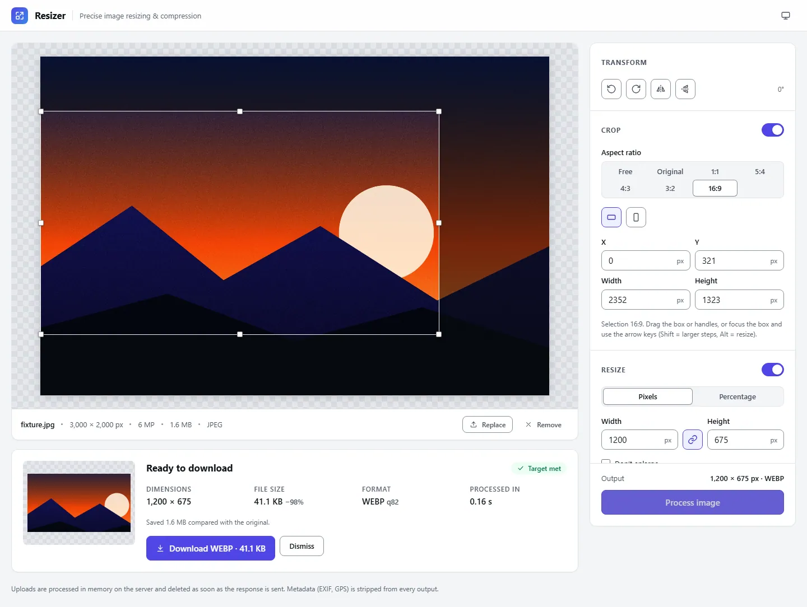
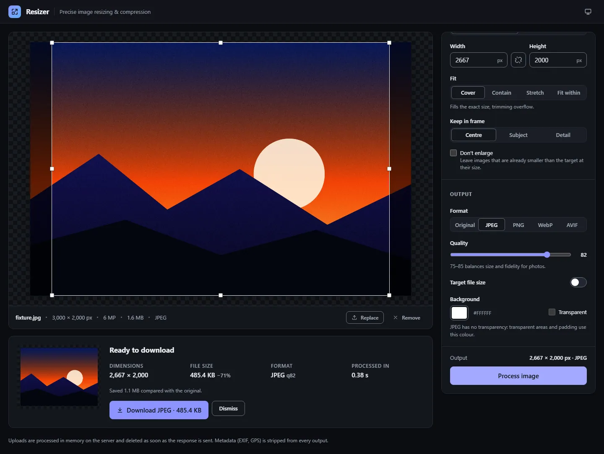
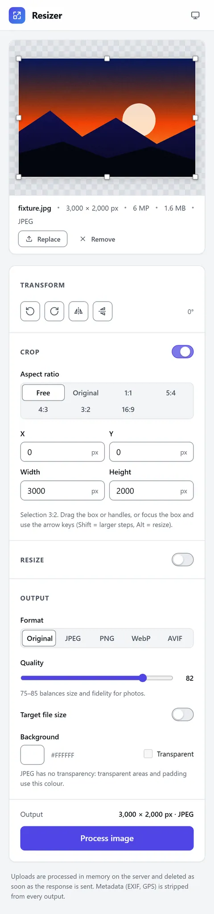

# Resizer: secure image resizing and compression

A single-page app and a stateless API for precise image work. You can crop
with aspect locks, rotate, mirror, resize with five fit modes and
content-aware framing, convert to JPEG/PNG/WebP/AVIF, and compress to an
**exact target file size**. Uploads are processed and then deleted
immediately; nothing is stored.



<details>
<summary>Dark theme and mobile</summary>




</details>

## Highlights

- **What you see is what you get.** The canvas preview renders the same rotate → mirror → crop semantics as the server, and the UI predicts output dimensions with the same maths as sharp (tested against it).
- **Target file size.** A binary search finds the highest quality under your budget. If quality alone can't reach it, the image shrinks instead of turning to mush. The result says honestly whether the target was met.
- **Secure by default.** Formats are detected by magic bytes (SVG, HEIC, polyglots are rejected), decompression bombs are refused before decode, metadata and GPS are stripped, and uploads are deleted in five layers. The SPA runs under a strict CSP. There are no stored secrets and no AWS keys in CI (OIDC).
- **Ratings and reviews.** After a download, visitors are asked (once, inline, never in a pop-up) to rate their experience from 1 to 5 stars. Reviews scroll right-to-left below the editor, with a pause button and a static version for reduced motion. Spam links are held for approval.
- **Admin area.** At `/admin`, sign in with a password (only its scrypt hash is stored) to approve, hide or delete reviews, or to switch the whole review section off.
- **Accessible.** Targets WCAG 2.2 AA, with 0 axe violations across 16 audited states in light, dark and mobile. The crop works fully by keyboard with a numeric alternative; there is a live region, a skip link, and support for reduced motion and forced colours.
- **Production path included.** CloudFormation for S3 + CloudFront (OAC) plus either **one EC2 server** (starter, about US$20–25/month) or an **ALB + Auto Scaling group**, a DynamoDB table for reviews, a hardened systemd unit, checksum-verified releases, SSM deploys with automatic rollback, and GitHub Actions CI/CD. A [click-by-click console guide](docs/AWS_CONSOLE_GUIDE.md) goes from buying the domain to a live site.

## Quick start

Requires **Node.js ≥ 22.12**.

```bash
npm ci
cp server/.env.example server/.env   # optional; every setting has a safe default
npm run dev                          # API on :8080, app on http://localhost:5173
```

The Vite dev server proxies `/api` to the API, so development is same-origin
just like production. Locally, reviews are saved to `server/.data/feedback.json`
(gitignored). To try the admin area at <http://localhost:5173/admin>:

```bash
npm run admin:hash-password -w server   # prompts for a password; paste both printed lines into server/.env
```

### Scripts

| Command | What it does |
| --- | --- |
| `npm run dev` | API (tsx watch) and SPA (Vite) together |
| `npm run check` | Typecheck, lint, all unit/integration tests, production build |
| `npm test` | Server (200) and client (43) tests. Set `DYNAMODB_ENDPOINT` to also run the DynamoDB store against [DynamoDB Local](https://hub.docker.com/r/amazon/dynamodb-local): `docker run -d -p 127.0.0.1:8000:8000 amazon/dynamodb-local:3.3.1 -jar DynamoDBLocal.jar -inMemory` |
| `npm run test:e2e` | After `npm run build`: Playwright journey (editor, feedback, review wall, admin) + axe WCAG 2.2 AA audits against the production build (first time: `npx playwright install chromium`) |
| `npm run admin:hash-password -w server` | Generate `ADMIN_PASSWORD_HASH` and `ADMIN_SESSION_SECRET` |
| `npm run build` | `server/dist` and `client/dist` |
| `npm start` | Run the built API (set `STATIC_DIR=client/dist` to serve the SPA too) |
| `npm run audit:prod` | Fail on high/critical advisories in production dependencies |

## Project layout

```text
client/                 React 19 SPA (Vite)
  src/App.tsx             shell: loading, processing, announcements, shortcuts
  src/state.ts            editor reducer → API options (single source of truth)
  src/components/         Stage, CropOverlay, Panels, ResultCard, FeedbackForm/Prompt, ReviewWall, Stars
  src/admin/              /admin moderation UI (lazy-loaded chunk)
  src/lib/                api + feedback clients, crop geometry, formatting
server/                 Express 5 API
  src/config/env.ts       validated environment configuration
  src/services/           sniffer, options schema, geometry, processor, target-size search, temp store
  src/services/feedback/  feedback service + memory/file/DynamoDB stores, text screening
  src/routes/             images, feedback, admin
  src/middleware/         security headers, CORS, origin verify, uploads, errors
  src/cli/                admin password hashing
  test/                   unit, pipeline, store-contract and HTTP tests
e2e/run.mjs             end-to-end + accessibility suite
infra/
  aws/cloudformation/     single-server.yaml (starter), compute.yaml (HA), edge.yaml (S3+CloudFront), github-oidc.yaml
  ec2/                    bootstrap, deploy, systemd unit, nginx (tls / alb profiles)
  scripts/                release packaging
.github/workflows/      ci.yml, deploy.yml
docs/                   console guide, design, API, deployment, security, accessibility
```

## Documentation

| Document | Contents |
| --- | --- |
| [AWS console guide](docs/AWS_CONSOLE_GUIDE.md) | **Start here to go live.** Domain purchase to a running site in Sydney, click by click |
| [System design](docs/SYSTEM_DESIGN.md) | Architecture, request lifecycle, pipeline semantics, target-size algorithm, temp-file lifecycle, sizing, trade-offs |
| [API reference](docs/API.md) · [OpenAPI 3.1](docs/openapi.yaml) | Endpoints, options, headers, error codes, examples |
| [Deployment](docs/DEPLOYMENT.md) | AWS setup step by step, CI/CD pipelines, configuration and secrets, rollback, operations |
| [Security](docs/SECURITY.md) | Threat model and controls, environment and secret management, supply chain, host hardening |
| [Accessibility](docs/ACCESSIBILITY.md) | WCAG 2.2 AA mapping, testing, known limitations |

## Configuration

All API settings are environment variables, validated at boot. See
[`server/.env.example`](server/.env.example) for the full list with defaults.
In production they come from AWS SSM Parameter Store. **Never commit `.env`
files.** They are gitignored, and CI scans the full history with gitleaks.
The SPA has one optional, public build variable, `VITE_API_BASE_URL`
([`client/.env.example`](client/.env.example)).

## Tech stack

React 19, TypeScript 6, Vite 8 · Node 22, Express 5, sharp 0.35 (libvips
8.18), multer 2, zod 4, helmet 8, pino 10, AWS SDK v3 · Vitest 5, supertest,
DynamoDB Local, Playwright, axe-core · AWS CloudFront (+ Functions), S3, EC2
(Graviton), DynamoDB, Route 53, ACM, Let's Encrypt, SSM, GitHub Actions (OIDC).
