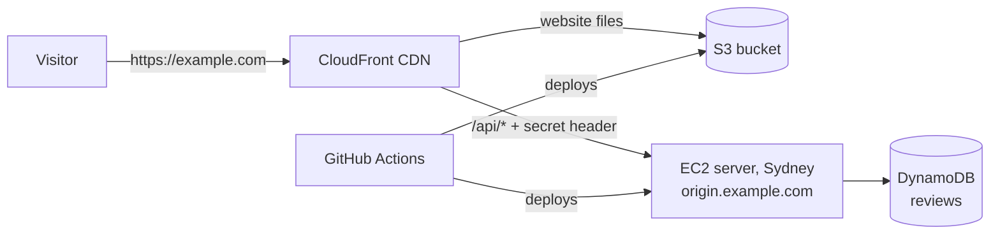

# Go live on AWS: step-by-step console guide

This guide takes you from an AWS account to a live site at `https://yourdomain.com`,
using only the AWS web console, GitHub's website and a few commands on your own
computer. It uses the **starter single-server** setup in **Sydney
(`ap-southeast-2`)**, next to your other projects.

Wherever you see **`example.com`**, type your own domain instead.

> **Time:** about 2 hours of clicking, plus waiting for the domain (15 minutes
> to a day) and the certificate (usually a few minutes).
> **Cost:** roughly **US$20–25 a month** plus the domain (about US$15 a year for
> `.com`). See [Monthly cost](#monthly-cost) and check the
> [AWS Pricing Calculator](https://calculator.aws/) for current prices.

## What you are building



- **CloudFront** serves the website worldwide over HTTPS and forwards `/api/*` to your server.
- **S3** stores the website files privately; only CloudFront can read them.
- **EC2** is one small Graviton server that processes images. It accepts traffic only from CloudFront, has no SSH, and its HTTPS certificate renews automatically.
- **DynamoDB** stores ratings and reviews, with point-in-time backups.
- **GitHub Actions** tests and deploys every push to `main`. It signs in to AWS with short-lived credentials, so no AWS keys are stored anywhere.

## Contents

1. [Secure your AWS account](#1-secure-your-aws-account)
2. [Buy your domain in Route 53](#2-buy-your-domain-in-route-53)
3. [Request the website certificate (N. Virginia)](#3-request-the-website-certificate-n-virginia)
4. [Put the code on GitHub](#4-put-the-code-on-github)
5. [Collect four IDs from the console](#5-collect-four-ids-from-the-console)
6. [Create the server stack](#6-create-the-server-stack)
7. [Store secrets in Parameter Store](#7-store-secrets-in-parameter-store)
8. [Create the website (CloudFront) stack](#8-create-the-website-cloudfront-stack)
9. [Let GitHub deploy to AWS](#9-let-github-deploy-to-aws)
10. [Configure the GitHub environment](#10-configure-the-github-environment)
11. [First deployment](#11-first-deployment)
12. [Check everything works](#12-check-everything-works)
13. [Everyday operations](#13-everyday-operations)
14. [Before you apply for AdSense](#14-before-you-apply-for-adsense)
15. [Troubleshooting](#15-troubleshooting)

---

## 1. Secure your AWS account

Skip any step you have already done for your other projects.

1. Sign in at <https://console.aws.amazon.com> as the **root user** (the account email).
2. Top-right menu (your account name) → **Security credentials** → **Multi-factor authentication (MFA)** → **Assign MFA device**. Use an authenticator app.
3. Stop using root for daily work. Open **IAM** → **Users** → **Create user**:
   - User name: `admin-yourname`. Tick **Provide user access to the AWS Management Console**.
   - Permissions: **Attach policies directly** → `AdministratorAccess`.
   - After creating it, open the user → **Security credentials** → assign MFA.
   - Sign out, then sign in with the IAM user's sign-in URL (shown on the IAM dashboard).
4. **Set a budget alarm.** Search **Budgets** → **Create budget** → **Use a template** → **Monthly cost budget** → amount `30` (USD) → your email → **Create**.
5. **Choose the region.** In the region picker (top right), select **Asia Pacific (Sydney) ap-southeast-2**. Use Sydney for everything except step 3.

## 2. Buy your domain in Route 53

1. Search **Route 53** → left menu **Registered domains** → **Register domains**.
2. Type the name you want → **Search**. Pick an available one → **Select** → **Proceed to checkout**.
   - `.com` is the safest choice for AdSense and for users. `.com.au` requires an Australian ABN/ACN. `.app` and `.dev` work well too; they force HTTPS, which this site already uses.
3. Duration **1 year**, **Auto-renew: on** → **Next**.
4. Contact details: fill them in accurately. Keep **Privacy protection** **on**; it hides your details from public WHOIS.
5. **Submit**. Route 53 automatically creates a **hosted zone** for the domain, which is where its DNS records live.
6. **Check your email** and click the verification link. Unverified domains are suspended after 15 days.
7. Wait until **Registered domains** shows the domain as registered. This usually takes 15–60 minutes and can take longer for some endings.

## 3. Request the website certificate (N. Virginia)

CloudFront only accepts certificates created in **US East (N. Virginia)**. This is the one exception to "everything in Sydney".

1. Switch the region picker to **US East (N. Virginia) us-east-1**.
2. Search **Certificate Manager** → **Request** → **Request a public certificate** → **Next**.
3. **Fully qualified domain name:** `example.com` → **Add another name to this certificate** → `www.example.com`.
4. Validation method **DNS validation** · Key algorithm **RSA 2048** → **Request**.
5. Open the certificate → **Create records in Route 53** → select both → **Create records**.
6. Wait until the status is **Issued** (usually 2–10 minutes). Copy the **ARN** (`arn:aws:acm:us-east-1:…`) for step 8.
7. **Switch the region back to Sydney.**

> The server's own certificate for `origin.example.com` is issued automatically from Let's Encrypt during the first deploy, so there's nothing to do for it here.

## 4. Put the code on GitHub

1. On <https://github.com> → **New repository** → name `image-resizer` → **Private** → **Create repository** (don't add a README).
2. On your computer, in the project folder:

   ```powershell
   git add -A
   git status            # check: no .env files, no .data/ folder, no release/ folder
   git commit -m "Initial import"
   git remote add origin https://github.com/YOUR-USER/image-resizer.git
   git push -u origin main
   ```

   The CI workflow starts automatically. It should turn green in about 5 minutes.
3. Repository **Settings → Code security**: turn on **Secret scanning** and **Push protection** (if your plan offers them) and **Dependabot alerts**.

## 5. Collect four IDs from the console

Everything below is in **Sydney**. Paste the values into a notepad; you'll need them in step 6.

| Value | Where to find it |
| --- | --- |
| **Hosted zone ID** (`Z…`) | Route 53 → **Hosted zones** → your domain → **Hosted zone details** → *Hosted zone ID* |
| **Default VPC ID** (`vpc-…`) | VPC → **Your VPCs** → the one with *Default VPC = Yes* |
| **Public subnet ID** (`subnet-…`) | VPC → **Subnets** → filter by that VPC → any subnet (default-VPC subnets are public) |
| **CloudFront prefix list ID** (`pl-…`) | VPC → **Managed prefix lists** → search `cloudfront.origin-facing` → *Prefix list ID* |

> Don't have a default VPC? VPC → **Your VPCs** → **Actions** → **Create default VPC**.

## 6. Create the server stack

This one step creates the server, its firewall, the reviews database, the private release bucket, the `origin.example.com` DNS record and the server's narrowly scoped permissions.

1. Search **CloudFormation** (region **Sydney**) → **Create stack** → **With new resources (standard)**.
2. **Upload a template file** → choose `infra/aws/cloudformation/single-server.yaml` from the project → **Next**.
3. **Stack name:** `image-resizer-server`. Parameters:

   | Parameter | Value |
   | --- | --- |
   | Your domain | `example.com` (lower case, no `www`) |
   | Route 53 hosted zone | pick your domain from the list |
   | Email for certificate expiry notices | your email (optional) |
   | VpcId / A PUBLIC subnet | the IDs from step 5 |
   | CloudFront prefix list ID | the `pl-…` value from step 5 |
   | InstanceType | `t4g.small` (you can change this later) |
   | Other parameters | leave the defaults |

4. **Next** → leave options as they are → **Next** → tick **I acknowledge that AWS CloudFormation might create IAM resources** → **Submit**.
5. Wait for **CREATE_COMPLETE** (about 3–5 minutes). Open the **Outputs** tab and note:
   - `ArtifactBucketName`
   - `OriginDomainName` (e.g. `origin.example.com`)
   - `FeedbackTableName`

> The server boots and waits. Nothing is installed on it yet; the first deployment in step 11 sets it up.

## 7. Store secrets in Parameter Store

The server reads its settings from **Systems Manager → Parameter Store** under `/image-resizer/prod/`. First generate three secrets **on your own computer** in the project folder:

```powershell
# 1) Origin secret (the password CloudFront uses to prove it's CloudFront)
node -e "console.log(require('crypto').randomBytes(32).toString('base64url'))"

# 2) + 3) Admin password hash and session secret (prompts for a new admin password, min 12 chars)
npm run admin:hash-password -w server
```

Keep the admin password in a password manager. Only its hash goes to AWS.

Then, in **Sydney**, search **Systems Manager** → **Parameter Store** → **Create parameter**, once per row:

| Name | Type | Value |
| --- | --- | --- |
| `/image-resizer/prod/ORIGIN_VERIFY_SECRET` | **SecureString** | output of command 1 |
| `/image-resizer/prod/ADMIN_PASSWORD_HASH` | **SecureString** | the `scrypt:…` value (everything after `ADMIN_PASSWORD_HASH=`) |
| `/image-resizer/prod/ADMIN_SESSION_SECRET` | **SecureString** | the value after `ADMIN_SESSION_SECRET=` |
| `/image-resizer/prod/TRUST_PROXY` | String | `2` |
| `/image-resizer/prod/PROCESSING_CONCURRENCY` | String | `1` (use `2` on `t4g.medium`) |
| `/image-resizer/prod/FEEDBACK_MODERATION` | String | `auto` (or `manual` to approve everything yourself) |

For SecureString, keep **KMS key source: My current account** and the default key `alias/aws/ssm`.

> Don't add `AWS_REGION` or `FEEDBACK_TABLE`; the server stack provides them. Every other setting has a safe default ([`server/.env.example`](../server/.env.example) lists them all).

## 8. Create the website (CloudFront) stack

1. **CloudFormation** (Sydney) → **Create stack** → upload `infra/aws/cloudformation/edge.yaml` → **Next**.
2. **Stack name:** `image-resizer-web`. Parameters:

   | Parameter | Value |
   | --- | --- |
   | API origin | `origin.example.com` (the `OriginDomainName` output from step 6) |
   | Origin secret | the **same** value as `ORIGIN_VERIFY_SECRET` |
   | Website domain | `example.com` |
   | IncludeWww | `true` |
   | ACM certificate ARN | the us-east-1 ARN from step 3 |
   | HostedZoneId | the `Z…` ID from step 5 (DNS records are then created for you) |
   | PriceClass | `PriceClass_200` (includes Australia and Asia) |
   | WebAclArn | leave empty for now |

3. **Next** → **Next** → **Submit**. CloudFront takes **5–15 minutes**. Note these values from the **Outputs** tab:
   - `SiteBucketName`
   - `DistributionId`
   - `SiteUrl`

## 9. Let GitHub deploy to AWS

This creates a role that **only** your repository's `production` environment can use, and only for this app's bucket, CDN and tagged server.

1. First check whether your account already trusts GitHub (from another project): **IAM** → **Identity providers**. If `token.actions.githubusercontent.com` is listed, copy its **ARN**.
2. **CloudFormation** (Sydney) → **Create stack** → upload `infra/aws/cloudformation/github-oidc.yaml`.
3. **Stack name:** `image-resizer-github`. Parameters:

   | Parameter | Value |
   | --- | --- |
   | GitHubOwner | your GitHub username (or organisation) |
   | GitHubRepository | `image-resizer` |
   | GitHubEnvironment | `production` |
   | ExistingOidcProviderArn | the ARN from step 1, or empty to create one |
   | SiteBucketName / DistributionId | outputs of `image-resizer-web` |
   | ArtifactBucketName | output of `image-resizer-server` |
   | EnvironmentName | `production` |

4. Tick the IAM acknowledgement → **Submit** → copy the `DeployRoleArn` output.

## 10. Configure the GitHub environment

In your repository → **Settings** → **Environments** → **New environment** → `production`:

1. **Deployment protection rules:** tick **Required reviewers** and add yourself, so every deploy waits for your approval. Under **Deployment branches**, choose **Selected branches** → add `main`.
2. **Environment variables** → **Add variable** for each of these (none of them are secrets):

   | Name | Value |
   | --- | --- |
   | `AWS_REGION` | `ap-southeast-2` |
   | `AWS_DEPLOY_ROLE_ARN` | `DeployRoleArn` from step 9 |
   | `ARTIFACT_BUCKET` | `ArtifactBucketName` from step 6 |
   | `SITE_BUCKET` | `SiteBucketName` from step 8 |
   | `CLOUDFRONT_DISTRIBUTION_ID` | `DistributionId` from step 8 |
   | `PUBLIC_URL` | `https://example.com` |
   | `DEPLOY_ENVIRONMENT_TAG` | `production` |

3. **Settings** → **Branches** → **Add branch ruleset** (or a protection rule) for `main`: require a pull request and require the **CI** checks to pass.

## 11. First deployment

1. GitHub → **Actions** → **Deploy** → **Run workflow** (or push any commit to `main`).
2. The **build** job runs all tests. **deploy-api** then waits for approval: click **Review deployments** → **Approve and deploy**.
3. The first run on the server takes **8–12 minutes**. It:
   - installs security updates, nginx and a checksum-verified Node.js, and adds a swap file;
   - gets the Let's Encrypt certificate for `origin.example.com` (DNS proof through Route 53) and schedules automatic renewal;
   - downloads the release, verifies its checksum, installs it, starts the service and health-checks it.

   Later deploys take 2–3 minutes.
4. **deploy-web** uploads the website to S3 and refreshes CloudFront. Both jobs end with a smoke test against `PUBLIC_URL`.

## 12. Check everything works

1. Open `https://example.com`. The editor loads with a padlock. `https://www.example.com` redirects to the bare domain.
2. Resize an image and download it. The **"How was your experience?"** form appears below the result. Send a rating.
3. Scroll down: your review is in the moving **"What people are saying"** section. The **Pause reviews** button stops the motion.
4. Open `https://example.com/admin` and sign in with your admin password. You can:
   - **Hide**, **Show**, **Approve** or **Delete** any review. Reviews containing links, emails or phone numbers wait in **Pending review**.
   - Turn **Show reviews on the website** off to hide the whole section from visitors (feedback is still collected).
5. Security spot checks:
   - `https://origin.example.com/api/v1/capabilities` from your browser should **fail**, because the server only accepts CloudFront.
   - `https://example.com/api/v1/health` returns `{"status":"ok",…}`.

## 13. Everyday operations

| Task | How |
| --- | --- |
| Ship a change | Open a pull request → CI goes green → merge → approve the deploy. |
| See server logs | EC2 → Instances → `image-resizer-production` → **Connect** → **Session Manager** → `sudo journalctl -u image-resizer -f` |
| Change a setting | Edit the parameter in Parameter Store → re-run the **Deploy** workflow (it re-reads settings). |
| Change the admin password | Run `npm run admin:hash-password -w server` again, update both `ADMIN_*` parameters, then redeploy. Everyone gets signed out. |
| Bigger server | CloudFormation → `image-resizer-server` → **Update** → **Use current template** → `InstanceType = t4g.medium`, and set `PROCESSING_CONCURRENCY` to `2`. The server restarts, so expect a couple of minutes of downtime. |
| Restore reviews | DynamoDB → Tables → your table → **Backups** → **Restore to point in time** (last 35 days). |
| Roll back a bad release | Re-run the Deploy workflow for an earlier commit. A release that fails its health check is rolled back automatically. |

### Monthly cost

These are approximate Sydney on-demand prices for light traffic. Check the calculator for current prices.

| Item | ~ US$/month |
| --- | --- |
| EC2 `t4g.small` | 15–16 |
| Public IPv4 address | 3.6 |
| EBS 16 GB gp3 | 1.5–2 |
| Route 53 hosted zone | 0.50 |
| DynamoDB (on-demand + point-in-time backup) | < 1 |
| CloudFront + S3 | 0–1 (CloudFront's always-free tier covers 1 TB and 10 M requests per month) |
| **Total** | **≈ 21–24**, plus the domain (about US$15/year for `.com`) |

## 14. Before you apply for AdSense

AdSense reviews the whole site, not just the code. When you're ready, ask me to add the missing pieces:

- [ ] **Privacy policy** page. It must mention images being processed and deleted, the reviews you store, and Google's use of cookies for ads.
- [ ] **About** and **Contact** pages, plus useful written content (for example, guides on image sizes for passports, social media and web). A single tool page is often rejected as "low value content".
- [ ] **Consent banner** (a Google-certified CMP) for visitors from the EEA, UK and Switzerland.
- [ ] **`ads.txt`** at the site root with your publisher ID.
- [ ] **CSP update**: the strict Content-Security-Policy currently blocks third-party scripts, so AdSense's domains must be allowed deliberately.
- [ ] Reviews: keep **Pending review** tidy. Spam links on a page can hurt approval, which is why comments with links wait for you.

## 15. Troubleshooting

| Symptom | Likely cause | Fix |
| --- | --- | --- |
| Certificate stuck on **Pending validation** | DNS records not created | ACM → certificate → **Create records in Route 53**. Check the domain's name servers match the hosted zone (Route 53 → Registered domains → your domain). |
| Stack fails: *prefix list … rules limit* | The CloudFront prefix list counts as ~55 rules | Service Quotas → **Amazon VPC** → *Inbound or outbound rules per security group* → request 120. |
| **deploy-api** says "No running instances" | Wrong `DEPLOY_ENVIRONMENT_TAG` or region | It must equal the stack's `EnvironmentName` (`production`), and `AWS_REGION` must be `ap-southeast-2`. |
| **deploy-api** fails at *certbot* | Hosted zone or domain mismatch | The server stack's domain must be exactly the hosted zone's domain. Check with Session Manager: `sudo cat /var/log/letsencrypt/letsencrypt.log`. |
| Site shows **502** on `/api/*` | Server not deployed yet, or origin secret mismatch | Finish step 11. Make sure the CloudFront parameter and `ORIGIN_VERIFY_SECRET` hold the same value, then redeploy. |
| `/api/*` returns **403 forbidden** | Origin secret mismatch | As above. |
| `/admin` says **Admin area not enabled** | `ADMIN_*` parameters missing | Add both parameters from step 7 and redeploy. |
| Everyone shares one rate limit | `TRUST_PROXY` wrong | It must be `2` for this setup (CloudFront → nginx → app). |
| Budget alert email | Traffic grew, or leftover resources | Check **Cost Explorer**. To remove everything, delete the three stacks. The buckets and the reviews table are kept on purpose; empty or delete them by hand, and turn off the table's deletion protection first. |
