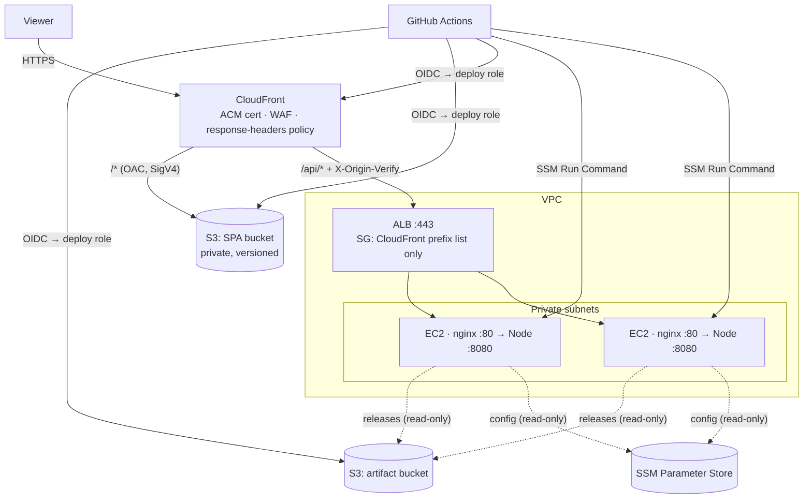
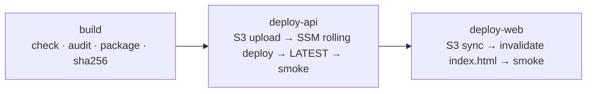

# Deployment: AWS S3 + CloudFront + EC2

> **Starting out?** Follow the [AWS console guide](AWS_CONSOLE_GUIDE.md). It
> covers the **starter single-server** setup (one EC2 instance in Sydney,
> about US$20–25/month) click by click, from buying the domain onwards. This
> runbook covers the **high-availability** setup (ALB + Auto Scaling group)
> using the AWS CLI. Both share the same pipeline, scripts and application.

| | Starter (single server) | High availability |
| --- | --- | --- |
| Template | [`single-server.yaml`](../infra/aws/cloudformation/single-server.yaml) | [`compute.yaml`](../infra/aws/cloudformation/compute.yaml) |
| API path | CloudFront → nginx :443 (Let's Encrypt) → Node | CloudFront → ALB (ACM) → nginx :80 → Node |
| nginx profile | `nginx-tls.conf` | `nginx-alb.conf` |
| `TRUST_PROXY` | `2` | `3` |
| Failure tolerance | A few minutes of downtime on deploys and instance loss | Rolling deploys, AZ-redundant |
| Approx. cost | US$20–25/month | US$110–130/month |

This runbook takes an empty AWS account to a production deployment with
continuous delivery from GitHub. The app runs in two parts: the SPA as static
files in **S3 behind CloudFront**, and the stateless API on **EC2** in an Auto
Scaling group behind an ALB. The browser sees a single origin. Reviews and
ratings live in a **DynamoDB** table created by the compute stack.

- [Topology](#topology)
- [What gets deployed where](#what-gets-deployed-where)
- [One-time setup](#one-time-setup)
- [The pipelines](#the-pipelines)
- [Configuration and secrets](#configuration-and-secrets)
- [Rollback](#rollback)
- [Operations](#operations)
- [Single-instance variant](#single-instance-variant)
- [Troubleshooting](#troubleshooting)

## Topology



**Security properties of this layout**

- The S3 bucket is fully private. Only this CloudFront distribution can read it (Origin Access Control plus a `AWS:SourceArn` condition).
- The ALB security group admits only CloudFront's origin-facing IP ranges, and the app also requires the `X-Origin-Verify` secret. Together these block direct access to the origin that would bypass WAF.
- Instances have no public IP, no SSH and no inbound ports except 80 from the ALB. Humans use SSM Session Manager.
- IMDSv2 is required, EBS is encrypted, and the service runs as an unprivileged user under a hardened systemd sandbox.
- GitHub authenticates with OIDC, so no AWS access keys exist. The deploy role is scoped to one repository environment and to only the buckets, distribution and tagged instances it needs.

## What gets deployed where

| Artifact | Built by | Stored in | Served by |
| --- | --- | --- | --- |
| `client/dist` (SPA) | `vite build` | S3 site bucket: `assets/*` immutable for 1 y, `index.html` revalidated | CloudFront |
| `image-resizer-<version>.tgz` (API) | `infra/scripts/package-release.sh` | S3 artifact bucket `releases/` + `.sha256` sidecar | EC2 (`/opt/image-resizer/releases/<version>`) |
| `bootstrap.sh`, `fetch-and-deploy.sh` | copied from the release | S3 artifact bucket `bootstrap/` | EC2 first boot |
| `releases/LATEST` | deploy pipeline | S3 artifact bucket | read by new instances at boot |

The API tarball contains compiled JS, manifests, the lockfile and the deploy
scripts, but **no `node_modules`**. Each instance runs
`npm ci --omit=dev --ignore-scripts`, so sharp resolves the libvips binary
for its own architecture (x64 or Graviton arm64). Install hooks never run as
root.

## One-time setup

**Prerequisites:** AWS CLI v2, an AWS account with admin access for the
bootstrap, a VPC with ≥ 2 public and ≥ 2 private subnets (private subnets
need outbound HTTPS through a NAT gateway), a Route 53 hosted zone (or other
DNS), and the GitHub repository.

```bash
export AWS_REGION=eu-west-1            # API region
export APP=image-resizer
```

### 1. Certificates

- **Origin certificate** in `$AWS_REGION`, for a name like `origin.example.com`. The ALB presents it to CloudFront.
- **Viewer certificate** in **`us-east-1`**, for `resizer.example.com`. This one is optional; you can start on `*.cloudfront.net`.

```bash
aws acm request-certificate --domain-name origin.example.com --validation-method DNS --region "$AWS_REGION"
aws acm request-certificate --domain-name resizer.example.com --validation-method DNS --region us-east-1
```

Validate both with the DNS records ACM gives you.

### 2. Compute stack: ALB, Auto Scaling group, artifact bucket

```bash
PREFIX_LIST=$(aws ec2 describe-managed-prefix-lists --region "$AWS_REGION" \
  --filters Name=prefix-list-name,Values=com.amazonaws.global.cloudfront.origin-facing \
  --query 'PrefixLists[0].PrefixListId' --output text)

aws cloudformation deploy --region "$AWS_REGION" \
  --stack-name $APP-compute \
  --template-file infra/aws/cloudformation/compute.yaml \
  --capabilities CAPABILITY_IAM \
  --parameter-overrides \
    VpcId=vpc-0123 \
    PublicSubnetIds=subnet-a,subnet-b \
    PrivateSubnetIds=subnet-c,subnet-d \
    OriginCertificateArn=arn:aws:acm:$AWS_REGION:111122223333:certificate/… \
    CloudFrontPrefixListId=$PREFIX_LIST \
    MinSize=0 DesiredCapacity=0
```

This starts with **zero instances**. The first pipeline run publishes a
release, and the instances deploy it at boot (step 7). The CloudFront prefix
list counts heavily against the default rules-per-security-group quota. If
the stack fails on that, request a higher quota.

Point `origin.example.com` at the `LoadBalancerDNSName` output (Route 53
alias or CNAME).

### 3. API configuration in SSM Parameter Store

Each parameter under the path becomes one environment variable. Secrets are
`SecureString`.

```bash
SECRET=$(node -e "console.log(require('crypto').randomBytes(32).toString('base64url'))")
P=/image-resizer/prod
aws ssm put-parameter --region "$AWS_REGION" --name $P/ORIGIN_VERIFY_SECRET --type SecureString --value "$SECRET"
aws ssm put-parameter --region "$AWS_REGION" --name $P/TRUST_PROXY          --type String --value 3
aws ssm put-parameter --region "$AWS_REGION" --name $P/LOG_LEVEL            --type String --value info
aws ssm put-parameter --region "$AWS_REGION" --name $P/PROCESSING_CONCURRENCY --type String --value 2
# Admin area (review moderation). Prints both values; the password is never stored.
npm run admin:hash-password -w server
aws ssm put-parameter --region "$AWS_REGION" --name $P/ADMIN_PASSWORD_HASH  --type SecureString --value 'scrypt:…'
aws ssm put-parameter --region "$AWS_REGION" --name $P/ADMIN_SESSION_SECRET --type SecureString --value '…'
```

| Parameter | Production value | Why |
| --- | --- | --- |
| `ORIGIN_VERIFY_SECRET` | 32+ random bytes (SecureString) | Must equal the CloudFront origin header. |
| `ADMIN_PASSWORD_HASH`, `ADMIN_SESSION_SECRET` | From `npm run admin:hash-password` (SecureString) | Enable `/admin`. Omit both to disable the admin area. |
| `FEEDBACK_MODERATION` | `auto` (default) or `manual` | `auto` publishes immediately but holds comments with links or contact details. |
| `TRUST_PROXY` | `3` | Hops: CloudFront → ALB → nginx. The client IP is then read correctly and cannot be spoofed. |
| `PROCESSING_CONCURRENCY` | See the [sizing table](SYSTEM_DESIGN.md#concurrency-back-pressure-and-memory) | Memory-bound. |
| `LOG_LEVEL` | `info` | |
| `MAX_UPLOAD_MB` etc. | Optional overrides | The nginx `client_max_body_size` must stay ≥ `MAX_UPLOAD_MB + 1`. |

`NODE_ENV=production`, `HOST=127.0.0.1` and `PORT=8080` are enforced by the
systemd unit and cannot be overridden from SSM. `AWS_REGION` and
`FEEDBACK_TABLE` are written by the stack into `/etc/image-resizer/deploy.conf`
and added to the environment automatically. See
[`server/.env.example`](../server/.env.example) for every variable.

### 4. Edge stack: S3 + CloudFront

The stack can live in any region (the SPA bucket is created there). Only the
**viewer certificate** and a **WAF web ACL** must be created in **us-east-1**,
and they are referenced by ARN.

```bash
aws cloudformation deploy --region "$AWS_REGION" \
  --stack-name $APP-edge \
  --template-file infra/aws/cloudformation/edge.yaml \
  --parameter-overrides \
    ApiOriginDomainName=origin.example.com \
    OriginVerifySecret="$SECRET" \
    SiteDomainName=example.com IncludeWww=true \
    AcmCertificateArn=arn:aws:acm:us-east-1:111122223333:certificate/… \
    HostedZoneId=Z0123456789ABC
```

With `HostedZoneId` set, the stack creates the apex and `www` A/AAAA alias
records itself. A CloudFront Function redirects `www` to the apex and serves
`index.html` for extension-less paths such as `/admin`. **Recommended:**
attach an AWS WAF web ACL (`WebAclArn`) with the AWS managed common rule set
and a rate-based rule on `/api/*`, for example 300 requests per 5 minutes per
IP. That gives a global limit across all instances.

### 5. GitHub OIDC deploy role

```bash
aws cloudformation deploy --region "$AWS_REGION" \
  --stack-name $APP-github \
  --template-file infra/aws/cloudformation/github-oidc.yaml \
  --capabilities CAPABILITY_IAM \
  --parameter-overrides \
    GitHubOwner=your-org GitHubRepository=image-resizer GitHubEnvironment=production \
    SiteBucketName=<edge SiteBucketName> DistributionId=<edge DistributionId> \
    ArtifactBucketName=<compute ArtifactBucketName>
```

If the account already has a `token.actions.githubusercontent.com` provider,
pass `ExistingOidcProviderArn=…`.

### 6. GitHub environment

In **Settings → Environments → `production`**:

- **Protection rules:** required reviewers, and deployment branches limited to `main`.
- **Variables** (none of these are secrets):

| Variable | Value |
| --- | --- |
| `AWS_REGION` | API region, e.g. `eu-west-1` |
| `AWS_DEPLOY_ROLE_ARN` | `DeployRoleArn` output of the github stack |
| `ARTIFACT_BUCKET` | `ArtifactBucketName` output of the compute stack |
| `SITE_BUCKET` | `SiteBucketName` output of the edge stack |
| `CLOUDFRONT_DISTRIBUTION_ID` | `DistributionId` output of the edge stack |
| `PUBLIC_URL` | `https://resizer.example.com`, used for smoke tests |
| `DEPLOY_ENVIRONMENT_TAG` | `production` (must match the compute stack's `EnvironmentName`) |

Also enable **branch protection** on `main` with the CI checks as required,
plus **secret scanning** and **push protection** in the repository's security
settings.

### 7. First release, then scale out

1. Push to `main` (or run **Deploy** manually). With zero instances, the API job publishes the release, bootstrap scripts and `releases/LATEST`, then warns that nothing was running. The SPA is uploaded to S3.
2. Scale out:

   ```bash
   aws cloudformation deploy --region "$AWS_REGION" --stack-name $APP-compute \
     --template-file infra/aws/cloudformation/compute.yaml --capabilities CAPABILITY_IAM \
     --parameter-overrides MinSize=2 DesiredCapacity=2
   ```

   Each instance runs `bootstrap.sh`, which installs a checksum-verified Node.js and nginx, creates the service account and deploys `LATEST`. It becomes healthy in the target group within about 3–5 minutes.
3. Open `https://resizer.example.com`.

## The pipelines

### CI ([`.github/workflows/ci.yml`](../.github/workflows/ci.yml)): every PR and push to `main`

| Job | Checks |
| --- | --- |
| Secret scan | gitleaks (checksum-verified binary) over the **full git history**. |
| Quality | `npm ci` → typecheck → ESLint (incl. jsx-a11y strict) → unit/integration tests → build → `npm audit --omit=dev --audit-level=high` → ShellCheck → release packaging (which refuses secret-like files). |
| E2E + WCAG | Production build served by the real API; Playwright journey plus axe-core WCAG 2.2 AA audits; screenshots uploaded. |
| CodeQL | `security-extended` queries for JavaScript/TypeScript. |

All third-party actions are pinned to full commit SHAs. Dependabot updates
both npm packages and actions weekly.

### Deploy ([`.github/workflows/deploy.yml`](../.github/workflows/deploy.yml)): push to `main` or manual



1. **build.** Runs `npm run check` and the audit, then packages `image-resizer-<UTC timestamp>-<sha7>.tgz` and records its SHA-256.
2. **deploy-api** (environment `production`, OIDC):
   - uploads the tarball, the `.sha256` sidecar and the bootstrap scripts;
   - sends an **SSM Run Command** to instances tagged `App=image-resizer, Environment=production`, **one instance at a time**, stopping at the first failure (`--max-concurrency 1 --max-errors 0`). The command first re-runs the idempotent [`bootstrap.sh`](../infra/ec2/bootstrap.sh), so new or drifted instances converge (packages, Node, nginx profile, certificate). It then runs `image-resizer-deploy <version> <sha256>`;
   - on each instance, [`fetch-and-deploy.sh`](../infra/ec2/fetch-and-deploy.sh) verifies the checksum and unpacks, and [`deploy.sh`](../infra/ec2/deploy.sh) installs dependencies, checks that libvips loads, renders `/etc/image-resizer/env` from SSM, switches the `current` symlink atomically, restarts, and health-checks, **rolling back automatically** if the check fails;
   - writes `releases/LATEST` only after every instance succeeded, so replacement instances always boot a known-good version;
   - smoke-tests `/api/v1/health` through CloudFront.
3. **deploy-web.** Runs after the API, so a new SPA never calls an old API:
   - syncs `assets/` with `immutable` caching, keeping old hashed files for tabs that still hold the previous `index.html`;
   - syncs the entry points with `no-cache` and `--delete`;
   - invalidates `/` and `/index.html`, then smoke-tests.

**Downtime.** An instance is unavailable for about 1–3 s while Node restarts,
and in-flight requests are drained first. With two or more instances and
rolling deploys, the ALB keeps serving from the others. For strict zero
downtime, switch to ASG *instance refresh* (blue/green) using the same
bootstrap.

## Configuration and secrets

| Kind | Where it lives | How it reaches the app |
| --- | --- | --- |
| API runtime config and secrets | SSM Parameter Store `/image-resizer/prod/*` (SecureString for secrets) | `deploy.sh` renders `/etc/image-resizer/env` (`0640 root:image-resizer`) → systemd `EnvironmentFile`. |
| CloudFront origin secret | CloudFormation parameter (`NoEcho`) and SSM | CloudFront adds it as `X-Origin-Verify`; the app compares in constant time. |
| SPA build config | GitHub variable `VITE_API_BASE_URL` (optional, public) | Compiled into the bundle. **Never put secrets in `VITE_*`.** |
| CI → AWS credentials | None: GitHub OIDC | Short-lived STS session per job. |
| Local development | `server/.env` (gitignored) from `.env.example` | `node --env-file-if-exists`. |

The server validates its whole configuration at boot and refuses to start
on invalid values, naming the variable but never printing its value.

### Rotating the origin secret

Rotation needs no downtime because the API accepts two values during the
switch.

```bash
NEW=$(node -e "console.log(require('crypto').randomBytes(32).toString('base64url'))")
OLD=$(aws ssm get-parameter --name $P/ORIGIN_VERIFY_SECRET --with-decryption --query Parameter.Value --output text)
# 1. Instances accept both old and new values
aws ssm put-parameter --name $P/ORIGIN_VERIFY_SECRET_PREVIOUS --type SecureString --value "$OLD" --overwrite
aws ssm put-parameter --name $P/ORIGIN_VERIFY_SECRET          --type SecureString --value "$NEW" --overwrite
#    re-run the Deploy workflow (or redeploy the current version) so env files are re-rendered
# 2. CloudFront switches to the new value
aws cloudformation deploy --region "$AWS_REGION" --stack-name $APP-edge --template-file infra/aws/cloudformation/edge.yaml \
  --parameter-overrides OriginVerifySecret="$NEW"   # parameters not listed keep their current values
# 3. After the distribution has deployed, drop the old value and redeploy
aws ssm delete-parameter --name $P/ORIGIN_VERIFY_SECRET_PREVIOUS
```

## Rollback

- **Automatic.** A release that fails its health check on any instance is reverted on that instance, and the pipeline stops before touching the rest or `LATEST`.
- **Manual (redeploy an earlier version).** Every release stays in S3 for 180 days with its checksum:

  ```bash
  V=20260928094400-abc1234
  SHA=$(aws s3 cp s3://$ARTIFACT_BUCKET/releases/image-resizer-$V.tgz.sha256 -)
  jq -n --arg c "/usr/local/sbin/image-resizer-deploy $V $SHA" '{commands: [$c]}' > rollback.json
  aws ssm send-command --document-name AWS-RunShellScript \
    --targets Key=tag:App,Values=image-resizer Key=tag:Environment,Values=production \
    --max-concurrency 1 --max-errors 0 \
    --parameters file://rollback.json
  echo "$V $SHA" | aws s3 cp - s3://$ARTIFACT_BUCKET/releases/LATEST
  ```

- **SPA.** The bucket is versioned. Re-run the Deploy workflow for the previous commit, or restore the previous `index.html` version and invalidate `/index.html`.

## Operations

| Task | How |
| --- | --- |
| Shell on an instance | `aws ssm start-session --target i-…` (no SSH keys and no bastion) |
| Service logs | `journalctl -u image-resizer -f` (structured JSON). Ship them to CloudWatch with the CloudWatch agent (`journald` input) if you need central search. |
| nginx logs | `/var/log/nginx/access.log`, `error.log` |
| Current release | `readlink /opt/image-resizer/current` |
| Scale | Change `MinSize`/`MaxSize`/`DesiredCapacity`; CPU target tracking (60%) scales within the bounds. |
| OS patching | Every deploy re-runs `bootstrap.sh`, which applies the latest AL2023 security updates (`--releasever=latest --security`). For kernel updates, reboot via Session Manager or start an ASG instance refresh. |
| Reviews backup | The DynamoDB table has point-in-time recovery (35 days) and deletion protection. |
| Health | ALB target health, `/api/v1/health`, and `/api/v1/ready` (503 when saturated). |
| Suggested alarms | ALB `HTTPCode_Target_5XX_Count`, `TargetResponseTime` p95, `HealthyHostCount < 2`, WAF blocked-request spikes. |

**Rough monthly cost** (eu-west-1, on-demand, light traffic): 2 × t4g.medium
≈ $50, ALB ≈ $20, NAT gateway ≈ $35, plus CloudFront, S3 and WAF, which are
usage-based and typically a few dollars. Graviton instances are about 20%
cheaper than x86 and run sharp natively.

## Single-instance variant

[`single-server.yaml`](../infra/aws/cloudformation/single-server.yaml) implements it; the
[console guide](AWS_CONSOLE_GUIDE.md) walks through it. In summary:

- One Graviton instance in a public subnet with an Elastic IP. Its security group admits **443 only from the CloudFront prefix list**; no other ports are open.
- `NGINX_PROFILE=tls`: nginx terminates HTTPS for `origin.<domain>`. The certificate comes from Let's Encrypt through the **DNS-01** challenge (`certbot-dns-route53`), so port 80 stays closed. The instance role may change only the `_acme-challenge.origin.<domain>` TXT record, enforced by IAM condition keys. Renewal runs from a systemd timer that reloads nginx.
- A 2 GiB swap file is added on instances with less than 3.5 GiB of RAM.
- `TRUST_PROXY=2` (CloudFront → nginx → Node).
- The pipeline is unchanged: the SSM command runs the idempotent bootstrap and then the deploy, so the instance is provisioned on the first pipeline run.

## Troubleshooting

| Symptom | Likely cause | Fix |
| --- | --- | --- |
| CloudFront returns **502** on `/api/*` | Origin certificate name ≠ `ApiOriginDomainName`, or the ALB security group lacks the prefix list | Check the ACM cert covers the origin name, and check the SG rule. |
| API returns **403 `forbidden`** through CloudFront | Origin secret mismatch between CloudFront and SSM | Compare values; redeploy to re-render the env file. |
| All clients share one rate-limit bucket | `TRUST_PROXY` too low, so the proxy's IP is used | Set it to the exact hop count (3 with the ALB). |
| Instance never becomes healthy | `bootstrap.sh` failed (no NAT egress, or no `LATEST` yet) | `aws ssm start-session`, then check `/var/log/cloud-init-output.log`. |
| Deploy fails at "libvips" | Architecture mismatch or a corrupted install | The step runs before the traffic switch, so nothing changed. Check `npm ci` output in the SSM command log. |
| 413 from nginx before the API | `client_max_body_size` < `MAX_UPLOAD_MB` | Raise both together. |
| Old SPA after a deploy | `index.html` cached by the browser | It is served with `no-cache`, so a reload fixes it. Check the invalidation completed. |
