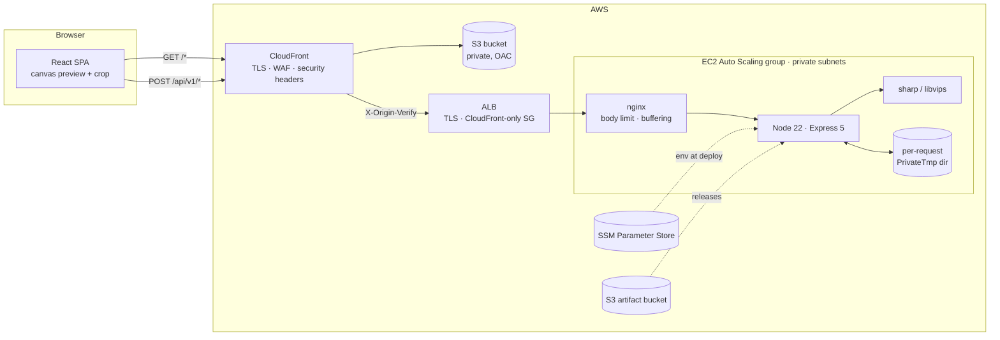
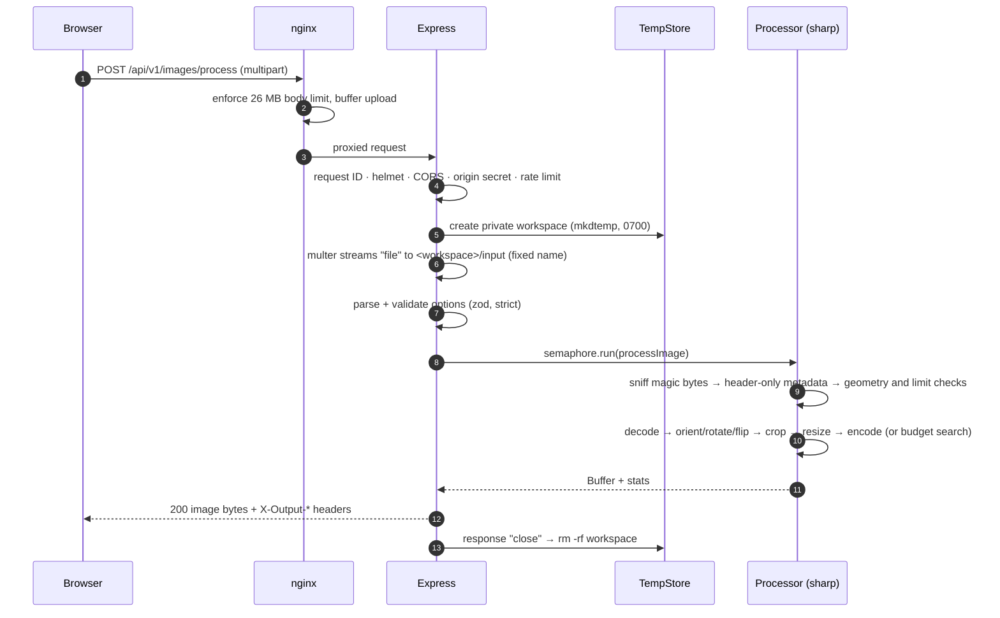
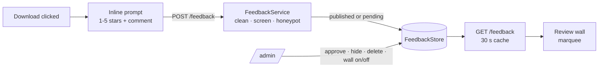

# System design

This document explains how Image Resizer is built and why. Read it before
changing the processing pipeline, the upload path, or the deployment topology.

- [Goals and non-goals](#goals-and-non-goals)
- [Architecture](#architecture)
- [Request lifecycle](#request-lifecycle)
- [Image pipeline](#image-pipeline)
- [Target file size algorithm](#target-file-size-algorithm)
- [Temporary file lifecycle](#temporary-file-lifecycle)
- [Concurrency, back-pressure and memory](#concurrency-back-pressure-and-memory)
- [Client architecture](#client-architecture)
- [Feedback and reviews](#feedback-and-reviews)
- [Observability](#observability)
- [Failure modes](#failure-modes)
- [Decisions and trade-offs](#decisions-and-trade-offs)
- [Testing strategy](#testing-strategy)

## Goals and non-goals

**Goals**

- Precise, predictable transforms: what the preview shows is exactly what the server produces.
- Hit a byte budget with the best achievable quality, and say so honestly when it cannot be hit.
- Treat every upload as hostile: content-based type detection, bounded decode, no persistence.
- Keep no user data. Nothing is stored after the response is sent.
- WCAG 2.2 AA across the UI.
- Stateless API instances, so scaling out is only a matter of adding instances.

**Non-goals**

- Accounts, galleries, or any storage of images.
- Animated output. GIF, WebP and TIFF inputs are processed from their first frame or page only.
- Batch processing in one request. Each request handles exactly one image.
- HEIC input. The prebuilt libvips has no HEVC decoder, for patent reasons.

## Architecture



The browser only ever talks to **one origin**. CloudFront serves the SPA from
S3 and routes `/api/*` to the API, so there is no CORS in production and the
CSP can say `connect-src 'self'`. Split-origin hosting is still supported
through `VITE_API_BASE_URL` plus `CORS_ORIGINS`.

### Server modules

| Module | Responsibility |
| --- | --- |
| [`config/env.ts`](../server/src/config/env.ts) | Validates every environment variable once at boot. Fails fast, naming variables but never echoing values. |
| [`app.ts`](../server/src/app.ts) | Composes middleware: request ID and logging → security headers → CORS → origin verification → routes → problem+json errors. |
| [`routes/api.ts`](../server/src/routes/api.ts) | `/health`, `/ready`, `/capabilities`, `/images/process`. |
| [`middleware/upload.ts`](../server/src/middleware/upload.ts) | Per-request workspace, bounded multipart parsing (multer), safe download names. |
| [`middleware/security.ts`](../server/src/middleware/security.ts) | Helmet policies (API and SPA), allowlist CORS, constant-time origin-secret check. |
| [`services/imageSniffer.ts`](../server/src/services/imageSniffer.ts) | Magic-byte format detection against an allowlist. |
| [`services/processOptions.ts`](../server/src/services/processOptions.ts) | Strict zod schema for the `options` field. |
| [`services/geometry.ts`](../server/src/services/geometry.ts) | Predicts output size before decoding, for limit checks. Mirrored in the client. |
| [`services/imageProcessor.ts`](../server/src/services/imageProcessor.ts) | The sharp pipeline: validate, transform, encode. |
| [`services/targetSize.ts`](../server/src/services/targetSize.ts) | Budget search, with the codec injected so it can be unit tested. |
| [`services/tempStore.ts`](../server/src/services/tempStore.ts) | Workspace creation, deletion, janitor, and boot purge. |
| [`lib/semaphore.ts`](../server/src/lib/semaphore.ts) | Bounded concurrency with a bounded queue that sheds load with 503. |

## Request lifecycle



Everything up to "decode" is cheap and bounded. A hostile file is rejected
before any pixel buffer is allocated.

## Image pipeline

**Order of operations**, which is also what the client preview renders:

1. **EXIF auto-orient.** The stored orientation tag is applied, so the user and the server see the same upright picture.
2. **Rotate** 0/90/180/270° clockwise.
3. **Flip** horizontally and/or vertically, in the rotated frame, i.e. on what the user sees.
4. **Crop.** The rectangle is expressed in the frame produced by steps 1–3.
5. **Resize** with `fit` and `position` (`attention`/`entropy` use libvips' saliency strategies).
6. **Flatten** onto `background` when the output has no alpha channel (JPEG).
7. **Encode**, and strip all metadata (EXIF, GPS, XMP, ICC). Output is converted to sRGB.

### Why flips run in a separate pass

sharp chains look declarative, but libvips runs them in a fixed internal
order. Measurements against sharp 0.35 found two problems:

| Chain | Observed behaviour |
| --- | --- |
| `flop().extract(r)` | extracts **before** mirroring, so the crop lands on the wrong side |
| `rotate(90).flip()` | mirrors **before** rotating, which contradicts the type definitions |
| `autoOrient` + one `rotate(n)` | composes correctly for all 8 EXIF orientations × 4 angles (40/40 checks) |

The pipeline therefore uses one of two paths:

- **No user flip** (the common case): a single streaming pipeline from disk, `sharp(file, {autoOrient}).rotate(n).extract().resize()`.
- **With a flip**: orient and rotate into raw pixels, mirror that raw buffer in a
  second pipeline, then crop, resize and encode in a third. Because each pass
  contains only order-independent operations, correctness does not depend on
  sharp internals.

[`imageProcessor.test.ts`](../server/test/imageProcessor.test.ts) pins these
semantics. It runs all 16 rotate × flip combinations and checks both the
corner colours and a crop of the top-left quadrant against a reference model.
A sharp upgrade that changes the ordering fails CI.

### Encoders

| Format | Settings | Rationale |
| --- | --- | --- |
| JPEG | mozjpeg (trellis, optimised progressive scans); 4:4:4 chroma at q ≥ 90 | About 10–15% smaller at equal quality; no colour bleed at high quality. |
| WebP | effort 4, smart subsampling | Good speed/size balance; sharper colour edges. |
| AVIF | effort 3 | AVIF encoding is CPU-heavy; effort 3 keeps budget searches within the time limit. |
| PNG | lossless: zlib 9 + adaptive filtering. Under a budget: libimagequant palette | PNG stays lossless unless a target size explicitly requires quantisation. |

`format: "original"` keeps JPEG/PNG/WebP/AVIF. GIF and TIFF are input-only and
map to PNG (if there is alpha) or JPEG.

## Target file size algorithm

[`targetSize.ts`](../server/src/services/targetSize.ts). The image is
decoded and transformed **once** into raw pixels; each attempt re-encodes
only from memory.

```text
for each size step (at most 8):
    if PNG: try lossless first
    encode at requested quality q_max          → fits? done (never degrade an image that already fits)
    encode at floor q_min (40, or 1 if no more shrinking is possible)
                                               → too big? shrink dimensions and continue
    binary-search q in (q_min, q_max)          → highest quality that fits
shrink factor = clamp(√(budget / smallest_bytes) × 0.93, 0.2, 0.9), resampled from the full-res source
```

- **Why a floor of 40.** Below it, compression artefacts cost more perceived quality than reducing dimensions does. The floor applies only while a smaller size is still possible; the final step searches down to q = 1.
- **Why √.** Encoded size scales roughly with pixel area, so shrinking each side by √r reduces bytes by about r. The 0.93 factor absorbs model error so the search seldom needs extra steps.
- **Honesty.** Only buffers actually measured under the budget are reported as `targetMet: true`. Otherwise the smallest encoding produced is returned with `X-Target-Met: false`.
- **Cost.** Each size step takes about 2 + log₂(q_max − q_min) encodes, which is 7 or 8. A deadline (`PROCESSING_TIMEOUT_SECONDS`) aborts runaway searches with `503 processing_timeout`.

## Temporary file lifecycle

Uploads are the only thing ever written to disk. Output is encoded in memory
and written straight to the socket. Deletion happens in layers:

| Layer | Mechanism | Covers |
| --- | --- | --- |
| 1 | `res.once('close')` → `rm -rf <workspace>` | Every normal path: success, validation error, client abort. `close` fires after `finish` or on disconnect. |
| 2 | Janitor every `max(10 s, TEMP_MAX_AGE/2)` removes workspaces older than `TEMP_MAX_AGE_SECONDS` | A failed `rm` (e.g. a Windows file lock) or a stuck request. |
| 3 | `TempStore.init()` purges the root at boot | Crash or kill mid-request. |
| 4 | systemd `PrivateTmp=true` | The service's `/tmp` is private and discarded whenever the service stops. |
| 5 | Graceful shutdown drains requests, then `purgeAll()` | Deploys and scale-in. |

Workspaces are created with `mkdtemp` under a `0700` root. The file is always
named `input`, so the client filename never touches the filesystem.
`release()` refuses to delete anything outside the root.

## Concurrency, back-pressure and memory

- **Semaphore.** Up to `PROCESSING_CONCURRENCY` jobs run at once (default: half the vCPUs, 1–4). libvips already parallelises each job across cores, so more concurrency only adds memory.
- **Bounded queue.** Up to `PROCESSING_QUEUE_LIMIT` jobs wait. Beyond that the API returns `503 server_busy` with `Retry-After`, and `/ready` reports `saturated` so a load balancer can steer traffic away.
- **Rate limit.** `RATE_LIMIT_MAX` requests per `RATE_LIMIT_WINDOW_SECONDS` per client IP, counted per instance. Use AWS WAF at CloudFront for a global limit.
- **Timeouts.** Headers 15 s, whole request 120 s (slow uploads), processing `PROCESSING_TIMEOUT_SECONDS`, enforced by sharp and by the budget search.
- **libvips cache disabled** (`sharp.cache(false)`). No decoded pixels survive between requests, which matters for both privacy and memory.

**Memory sizing.** The peak per job is roughly one to three raw frames of the
largest intermediate:

```text
peak ≈ W × H × 4 bytes × (1 streaming | 2 flip pass | 2 budget search)
50 MP input (default MAX_INPUT_PIXELS) → ~200 MB per raw frame
```

| Instance | vCPU / RAM | Suggested `PROCESSING_CONCURRENCY` |
| --- | --- | --- |
| t4g.small | 2 / 2 GiB | 1 (or lower `MAX_INPUT_PIXELS` to 25 MP) |
| t4g.medium | 2 / 4 GiB | 2 |
| c7g.xlarge | 4 / 8 GiB | 3–4 |

The systemd unit caps the service at `MemoryMax=80%`, so a pathological job
kills only the service, which is then restarted, and never the host.

## Client architecture

- **State.** One reducer ([`state.ts`](../client/src/state.ts)) holds geometry, crop, resize and output settings. `toProcessOptions()` is the only way UI state becomes an API request, and the result card flags itself stale when that serialisation changes.
- **Preview.** A canvas that renders the original with the *same* rotate-then-mirror semantics as the server, capped at 2048 px on the long side. Crop coordinates are always full-resolution pixels. The preview is only a view.
- **Rotating a mirrored image.** Output = flip(rotate(image)), so rotating what the user sees by 90° swaps the flip axes (R₉₀·Fₕ = Fᵥ·R₉₀). The reducer does this, and a property test asserts that "rotate clockwise" always rotates the visible image.
- **Crop.** Pure geometry functions ([`geometry.ts`](../client/src/lib/geometry.ts)) handle move, edge and corner resize with an optional aspect lock. The same rectangle can be edited by pointer, by keyboard, or through numeric fields.
- **Formats the browser cannot decode** (TIFF on most browsers): the client asks the API for a 2048 px WebP proxy using the normal `/process` endpoint. The proxy's `X-Input-Width/Height` give the true oriented dimensions, so crop coordinates still map to full resolution.
- **Capabilities.** Limits come from `GET /capabilities`, so the UI validates against the live server policy, with defaults as a fallback.
- **Upload progress** uses `XMLHttpRequest`, because `fetch` has no upload progress events.

## Feedback and reviews



- **Collection.** After the first download in a session, an inline form (not a modal) asks for a rating. It never takes focus from the download link. "Not now" suppresses it for 7 days, and a submission for 30 days (per browser, in `localStorage`). "Leave feedback" on the wall works at any time.
- **Moderation.** In `auto` mode (the default) comments publish immediately. Anything with a link, email or phone number waits as `pending`, which keeps spam off pages that will carry ads. In `manual` mode everything waits. Admins can publish, hide or delete any review, and switch the whole wall off.
- **Statistics.** The count, sum and per-star distribution are maintained **incrementally**. In DynamoDB each create or delete is a `TransactWriteItems` that writes the review and adjusts the counters atomically. Hiding changes visibility, not the average.
- **Stores.** One `FeedbackStore` interface has three implementations: memory (tests), JSON file (local development) and DynamoDB (production). A single contract test suite runs against all three; the DynamoDB run uses DynamoDB Local, in CI too.
- **DynamoDB layout** (single table, on-demand):

  | Item | `pk` | `sk` | `gsi1pk` / `gsi1sk` |
  | --- | --- | --- | --- |
  | Review | `FEEDBACK` | `<id>` | `STATUS#<status>` / `<id>` |
  | Rating counters | `STATS` | `RATINGS` | – |
  | Site settings | `SETTINGS` | `SITE` | – |

  Ids are time-sortable (base-36 timestamp + random), so the `gsi1` query by status returns the newest first without a sort key on dates. Volume is tiny and write-rate-limited, so a single partition is far below DynamoDB's per-partition limits.
- **Review wall.** Two identical lists translate by −50% for a seamless right-to-left loop, with duration proportional to the number of cards. Only the first copy is exposed to assistive technology. The wall pauses on hover or focus and has a Pause button (WCAG 2.2.2). With `prefers-reduced-motion` it becomes a static, keyboard-scrollable row.
- **Admin UI.** `/admin` is a lazily loaded chunk of the same SPA. Visitors never download it, and it is `noindex`.

## Observability

- **Logs.** Structured JSON from pino. Each request carries an ID that is returned as `X-Request-Id` and included in problem responses, so a user-reported error maps to one log line. Filenames, image bytes and secrets are never logged; `authorization`, `cookie` and `x-origin-verify` are redacted.
- **Probes.** `/api/v1/health` is liveness (used by the ALB). `/api/v1/ready` reports load and returns 503 when saturated.
- **Suggested alarms.** ALB 5XX rate, target response time p95, `HealthyHostCount < MinSize`, 429/503 rate, ASG CPU.

## Failure modes

| Failure | Behaviour |
| --- | --- |
| Corrupt or truncated image | `422 invalid_image`; the decoder aborts on errors (`failOn: 'error'`). |
| Decompression bomb | Rejected from the header by pixel count (`413 image_too_large`) before decode. |
| Oversized output request | Predicted by `computeOutputSize`, giving `422 output_too_large` before decode. |
| Burst beyond capacity | Queue, then `503 server_busy` + `Retry-After`; `/ready` reports 503. |
| Slow client upload | nginx buffers the body, so Node workers are not tied up. |
| Instance crash | ASG replaces it via ELB health checks; the new instance deploys `releases/LATEST` on boot. |
| Bad release | `deploy.sh` health-checks and restores the previous release; the pipeline stops at the first failed instance. |
| Origin hit directly | `403`: the ALB only admits CloudFront IPs, and the app requires the origin secret. |

## Decisions and trade-offs

| Decision | Alternatives | Why |
| --- | --- | --- |
| **sharp / libvips** | ImageMagick, Jimp, cloud services | Streaming and low memory, fast, actively patched, and no shell-out (ImageMagick's history of delegate/policy CVEs). |
| **Uploads to disk, output in memory** | All in memory; all on disk | Disk keeps many concurrent 25 MB uploads off the heap. Outputs are bounded and are written straight to the socket, so the processed image never touches disk. |
| **Stateless API, no object storage for results** | Upload to S3 and return presigned URLs | Nothing to delete or leak, and no lifecycle rules. The trade-off is that a result is gone once downloaded. |
| **Same-origin via CloudFront** | Separate API domain + CORS | Removes CORS and preflight latency, allows a tighter CSP, and gives a single WAF/TLS edge. |
| **EC2 + ASG** | Lambda, ECS Fargate | Long CPU-bound encodes and a 25 MB body fit awkwardly within Lambda's limits. EC2 gives predictable per-core cost and Graviton pricing. ECS is a reasonable next step; the app is already stateless. |
| **SSM Run Command deploys** | CodeDeploy, SSH | No inbound ports or SSH keys, auditable in CloudTrail, and the deploy logic is versioned inside each release. |
| **`npm ci` on the instance** | Ship `node_modules` from CI | sharp's native binary must match the instance OS and architecture (x64 or Graviton). `--ignore-scripts` keeps install hooks from running as root. |
| **Custom 50-line CORS** | `cors` package | Allowlist-only with no wildcard mode, so there is less surface. |
| **`role="application"` crop box** | `role="group"` | Screen readers must switch to focus mode for the arrow keys to work; see [ACCESSIBILITY.md](ACCESSIBILITY.md). |

## Testing strategy

| Layer | Tooling | What it proves |
| --- | --- | --- |
| Server unit | Vitest | Magic-byte sniffing, schema edge cases, config validation, semaphore behaviour, budget search on a model codec, geometry parity with real sharp output. |
| Server pipeline | Vitest + real sharp | All 16 transform combinations, EXIF orientation, CMYK, alpha flattening, metadata stripping, budget search per codec, hostile inputs (SVG, truncated, garbage, bombs). |
| Server HTTP | Vitest + supertest | Headers, problem+json, CORS, origin secret and rotation, rate limiting, upload limits, and that **the temp directory is empty after every response**. |
| Client unit | Vitest | Crop maths (move, resize, aspect lock, corner shrink), rotate/flip rect transforms, reducer invariants. |
| End to end | Playwright + axe-core | The full journey against the production build: keyboard and pointer crop, numeric entry, download verified with sharp, zero WCAG 2.2 AA violations in 9 UI states across light, dark and mobile, no CSP violations, and a server temp dir empty afterwards. |
| Infrastructure | cfn-lint, ShellCheck, actionlint | Templates, deploy scripts and workflows. |
